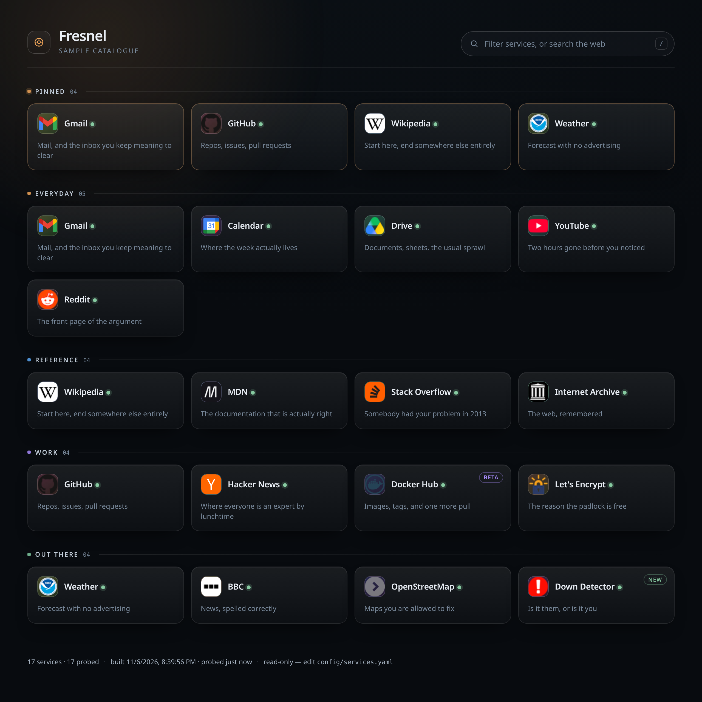
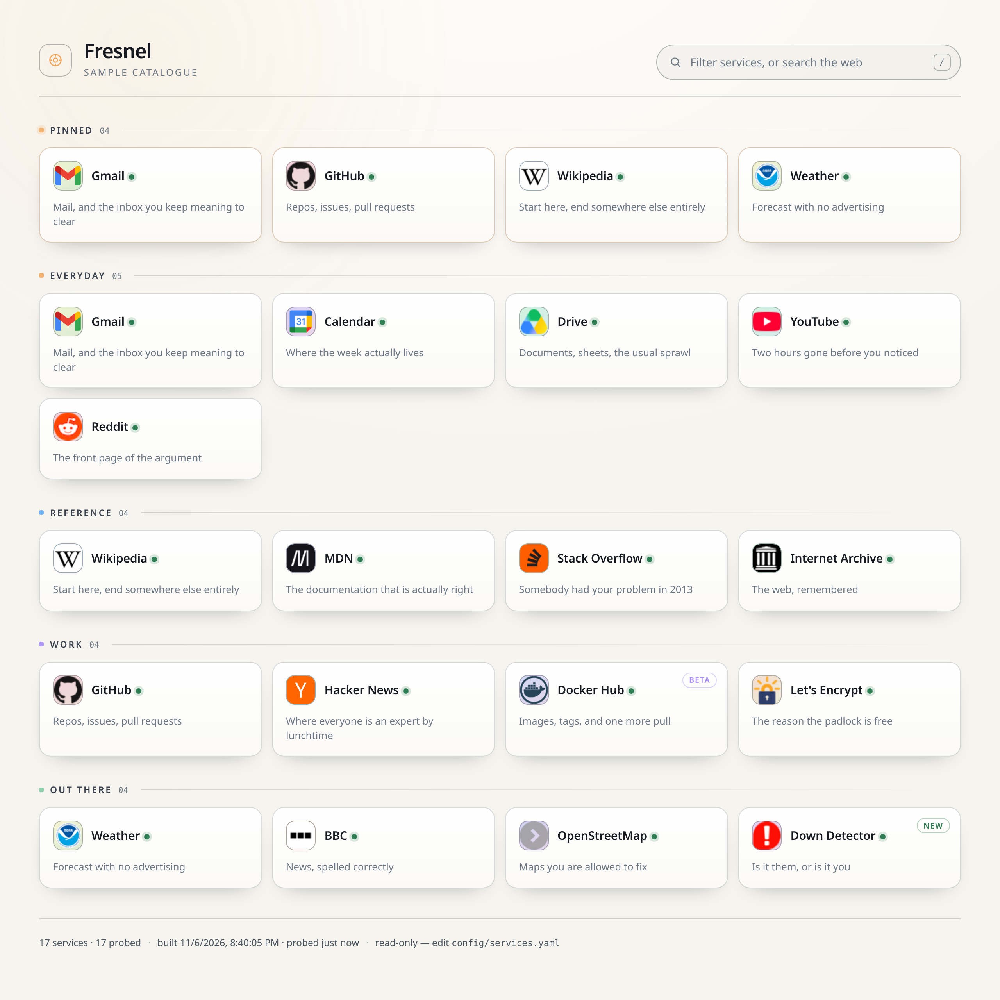

# Fresnel

A service catalogue that behaves like a document.

Heimdall is a dashboard you edit in the browser. Fresnel is a dashboard you edit in a text
file. The page has no write path: no forms, no sessions, no admin panel, no account. It reads
`services.json`, which is generated from `services.yaml`, and that is the entire loop.

Named for the lens in a lighthouse: the light is fixed, the room behind it is what changes.


*The page has no write path. The file is the dashboard.*

```
config/services.yaml  ──build──▶  site/services.json  ──render──▶  the page
     (humans, agents,                        (generated,          (read-only,
      scripts, git)                           committed)           no forms)
```



<details>
<summary>Light theme — <code>theme: light</code></summary>



</details>

## Why the page cannot be edited

Because the editor is the weakest link in every self-hosted dashboard:

- **No drift.** There is no state in a browser to get out of sync with state on disk.
- **No write surface.** Nothing to authenticate, nothing to CSRF-protect, nothing to
  escalate. The web server can be read-only and static.
- **Auditable by default.** Every change is a diff in a file. Who added that tile, when, and
  what did it look like before — `git log` answers all three.
- **Machine-editable.** Anything that can write text can maintain this page: a shell script, a
  provisioning system, a CI job, or a digital person with a text editor and a `make build`.
  No API client, no scraping a UI, no headless browser.

## Quick start

```bash
make build      # validate config/services.yaml, write site/services.json
make serve      # build, then serve on http://localhost:8088
make watch      # rebuild whenever the config changes
make check      # validate only, write nothing (use this in CI)
```

Requires Python 3 and PyYAML. The site itself is vanilla HTML/CSS/JS with no dependencies and
no CDN calls: it works on an isolated network.

## The config

```yaml
title: Fresnel
subtitle: homelab
accent: "#f2a65a"                # one accent colour, used sparingly
search_provider: duckduckgo      # duckduckgo | google | bing | none

categories:
  - name: Infrastructure
    services:
      - name: Gitea
        url: https://git.lan
        description: Repos, issues, actions
        tags: [git, ci, code]
        hue: 22                  # optional: colour of the tile mark
        monogram: G              # optional: 1-2 characters, default is the first letter
        icon: https://git.lan/favicon.ico   # optional: overrides the monogram
        status: beta             # optional: new | beta | down | planned
```

| Field | Required | Notes |
|---|---|---|
| `title` | no | page heading and `<title>` |
| `subtitle` | no | small uppercase line under the heading |
| `accent` | no | hex colour, drives the focus ring, the glow and the "beta" pill |
| `search_provider` | no | what Enter does when the filter finds nothing. `none` disables web search |
| `categories[].name` | yes | must be unique |
| `categories[].services[]` | yes | at least one per category |
| `services[].name` | yes | |
| `services[].url` | yes | must start with `http://` or `https://`, must be unique |
| `services[].description` | no | clamped to two lines so the grid stays even |
| `services[].tags` | no | searchable, never displayed |
| `services[].hue` | no | 0–360; if omitted, derived from the name so it is stable across rebuilds |
| `services[].monogram` | no | 1–2 characters |
| `services[].icon` | no | URL; falls back to the monogram if it fails to load |
| `services[].status` | no | `new`, `beta`, `down`, `planned` |

## The contract

The build **fails loudly** rather than emitting a broken page. A missing URL, a duplicate URL,
a typo'd status, an empty category — each one stops the build with the category name and the
service number:

```
services.yaml: category 'Infrastructure', service 3: `url` is required and must be a non-empty string
```

That is deliberate. The people most likely to edit this file are not the people who wrote it,
so the error message is the documentation.

## Deliberate differences from Heimdall

- **No writes.** There is no admin UI to disable, because there is no admin UI.
- **No database.** One YAML file in, one JSON file out. Backups are copies.
- **No invented health checks.** Tiles do not ping anything. A browser cannot read a
  cross-origin response without CORS on the target, so most "status lights" lie. Fresnel shows
  an **editorial** status you write yourself — human knowledge, not a fake probe.
- **Monogram-first icons.** A page of mismatched favicons looks like a bookmark folder. A grid
  of consistent, colour-coded marks looks like a product. Icons are opt-in per service.
- **One accent colour.** Heimdall's tiles each bring their own palette. Fresnel has one light
  source and a lot of restraint.

## Layout

```
config/services.yaml    the catalogue — the only file you edit
tools/build.py          validator + compiler (yaml → json)
site/index.html         the page
site/styles.css         the look
site/app.js             filtering, keyboard, search
site/services.json      generated; commit it if you serve from git
Makefile                build / check / serve / watch
```

## Running it in a container

```bash
make up      # build the image, start the container, http://localhost:8088
make logs    # follow
make down    # stop
```

`compose.yaml` is deliberately locked down:

| Setting | Why |
|---|---|
| `read_only: true` | nothing writes to the container's filesystem; `/tmp` and the nginx cache are tmpfs |
| `cap_drop: ALL` | no capabilities at all |
| `no-new-privileges` | a compromised process cannot gain more |
| runs as uid 101 | the unprivileged nginx image, not root |
| CSP + no-referrer + `X-Frame-Options: DENY` | a static page has no reason to load anything off-host |

**The config is validated at image build.** `tools/build.py` runs inside the Docker build stage, so a
catalogue with a missing URL or a duplicate service **fails the build** instead of shipping. A broken
config cannot reach a browser.

**Live editing without a rebuild.** `./site` is mounted read-only into the container. `make build` on
the host rewrites `site/services.json`, and the next page load picks it up — no restart, no image
rebuild. That is the integration point: any project that can write YAML and run one command can own
the dashboard.

## Tests and CI

```bash
python3 -m unittest discover -s tests -v
```

Eleven tests, all of them about the validator — because the validator is the product. If it lets a
broken catalogue through, the promise on this page is a lie. CI (`.github/workflows/ci.yml`) runs the
tests, validates the sample catalogue, builds it, and fails the run if `index.html` ever grows an
inline `<script>` (the shipped CSP forbids one).

## Publishing notes

**Never commit `site/status.json`.** It is generated by the probe and it names the hosts on your
network. It is in `.gitignore` for that reason.

**Keep your real `config/services.yaml` out of a public repo** if it names internal hosts. Publish the
sample catalogue and keep yours private, or keep the public one pointed at public sites.

**Screenshots live in `docs/`** and are referenced at the top of this file.

## Licence

MIT. See `LICENSE`.
